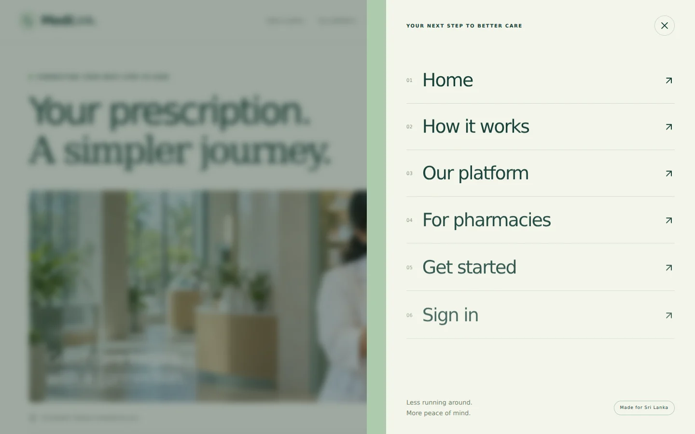
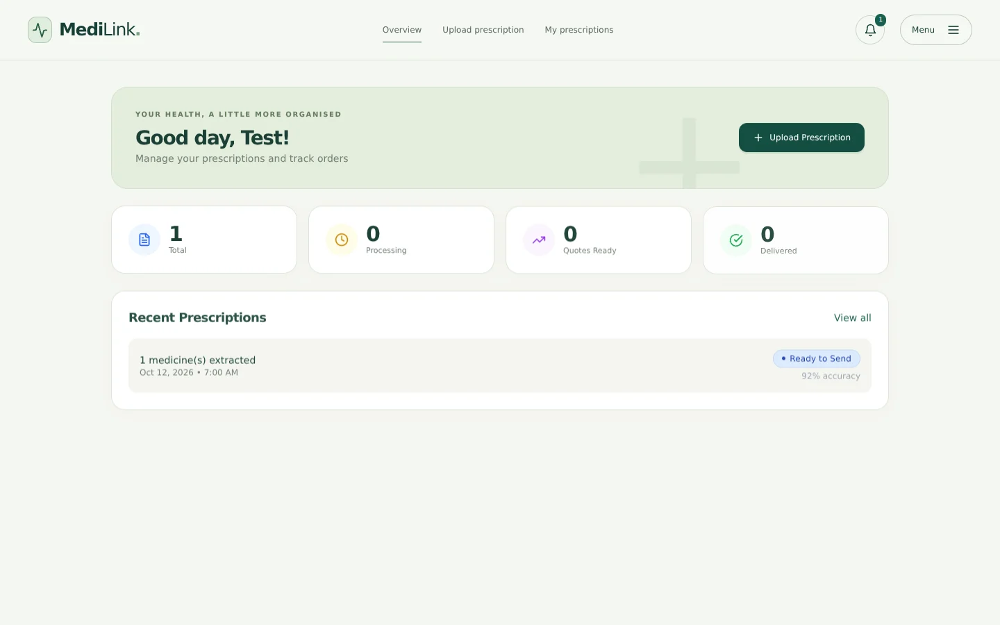
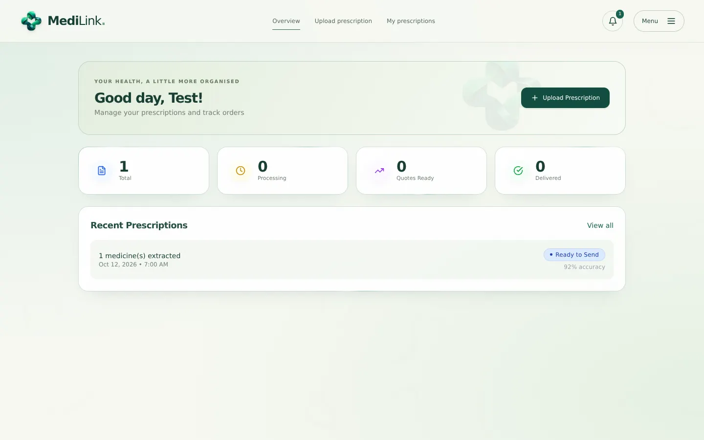
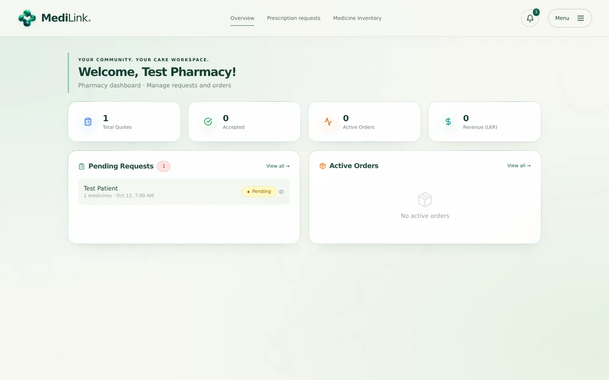
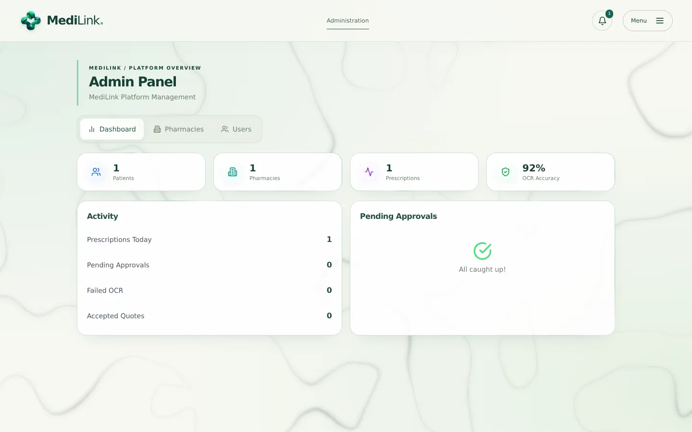
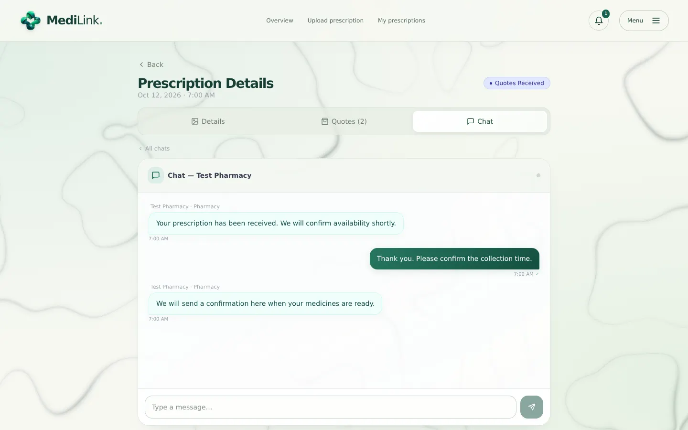
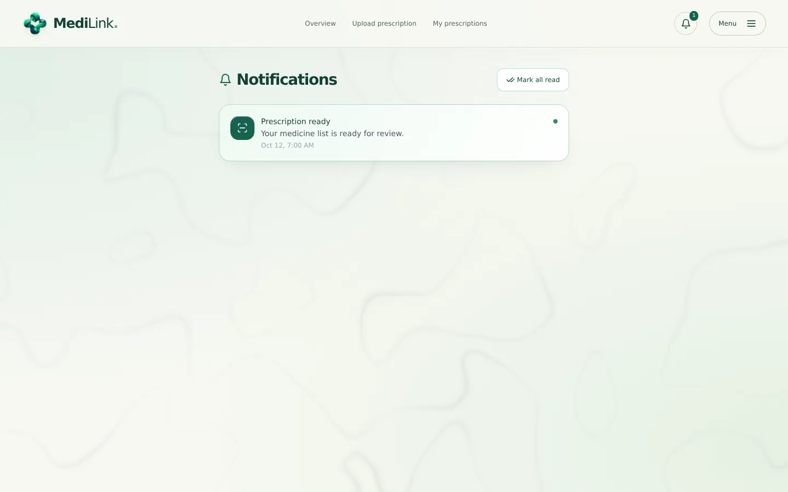
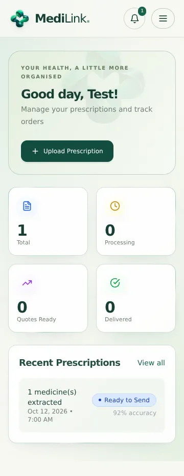
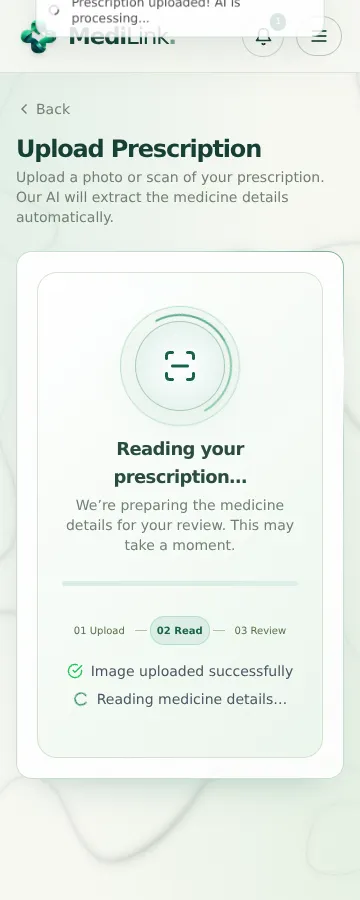
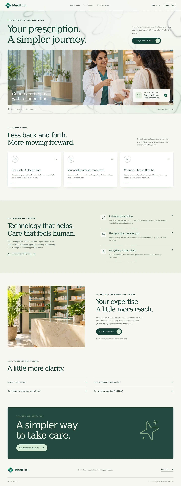

# MediLink frontend redesign

A warm ivory, deep teal, and mint interface for the existing MediLink application. All changes are contained in `frontend/`. Backend routes, AI services, API methods, socket context, and authentication context are unchanged.

## What changed

- A new editorial home page with two generated healthcare photographs, scroll-linked parallax, word-by-word heading entrances, section reveals, interactive cards, a pharmacy registration entry point, and expandable FAQs.
- A layered staggered menu for public, patient, pharmacy, and admin navigation. It supports Escape, focus trapping, focus restoration, background scroll locking, and accessible mobile labels.
- A shared visual system for buttons, cards, forms, status badges, tabs, tables, notifications, and loading states across all active routes.
- New split-layout authentication screens. `/register?role=pharmacy` selects pharmacy registration; the existing registration fields and payload remain in use.
- Animated upload/processing presentation reflects existing application states, without fabricated progress percentages.
- Responsive workspaces, horizontal scrolling within wide inventory tables, keyboard focus indicators, and reduced-motion alternatives.
- Route-level lazy loading keeps secondary application screens out of the home-page bundle.

The first pass established the MediLink direction. The premium refinement below incorporates the subsequently supplied React Bits and Uiverse references.

## Run on your computer

Use Node.js 22.12+ or a supported newer version (Node 24 was used for this build).

If using the downloadable ZIP, back up your existing `frontend/` folder, extract the included `frontend/` folder into your MediLink project, retain your existing `.env`, then run `npm ci` and `npm run dev` from that folder. The ZIP includes only the frontend.

After the redesign branch has been published, you can also obtain it through Git:

```sh
git fetch origin
git switch codex/medilink-premium-motion
cd frontend
npm ci
npm run dev
```

Open `http://localhost:3000`. Keep your existing frontend `.env` values and run your existing backend and AI service as described in the root setup guide. The public home and authentication UI can render without those services; authentication and data operations still require them.

```sh
npm run build
npm run preview
```

For a production host, retain the existing API/socket environment variables and configure SPA fallback to `index.html` for client-side routes.

## Existing build issues corrected

- The home-page import used `HomePage` while the tracked file is `Homepage.tsx`; corrected for case-sensitive operating systems.
- Updated the React Vite plugin to the Vite 8-compatible v6 series and regenerated the lockfile. This resolves the existing clean-install peer dependency conflict.
- Legacy, unrouted authentication pages referenced missing form libraries and a nonexistent `setAuth`. They now re-export the active forms.
- Added the optional `word_count` field to the frontend `WritingStyle` interface already used by the extraction-result display.

## Verification

- TypeScript and production Vite build pass.
- Browser checks at 1440px desktop and 390px phone widths cover the home page, login, registration, patient overview, upload, prescription list/details, notifications, pharmacy overview/requests/quotation/inventory, and admin dashboard/tabs.
- Verified menu focus trapping, Escape closure, restored focus, background inertness, hash navigation, scroll-linked parallax, password visibility, sign-in error feedback, pharmacy/patient registration selection, upload request fields, processing presentation, quotation-builder tabs, and reduced-motion rendering.
- No horizontal document overflow or uncaught page errors in the tested routes.
- API responses and writes were intercepted with synthetic fixtures for these checks. Live authentication, database persistence, AI extraction, socket completion, location services, and delivery/order operations were not end-to-end tested against production services.
- Verified zero changes to `backend/`, `ai-service/`, `frontend/src/services/`, and `frontend/src/context/`.

## Screenshots

Screenshots use synthetic test data, not real patient information.






[Mobile home screenshot](docs/home-mobile.webp)

## Generated assets

Created with the built-in image-generation tool and converted to local WebP assets. These are illustrative campaign images, not photographs of real MediLink facilities or staff.

- `public/images/medilink-care.webp` — 1855 × 848, approximately 116 KB. Used by the home-page hero and authentication layout.
- `public/images/medilink-pharmacy.webp` — 1024 × 1536, approximately 172 KB. Used by the pharmacy section.

### Hero prompt

Use case: photorealistic-natural. Asset type: wide cinematic homepage photograph for MediLink, a Sri Lankan prescription-to-pharmacy platform. Create a premium editorial photograph of a friendly Sri Lankan female pharmacist wearing a clean ivory lab coat over muted teal scrubs, handing a small unbranded paper medicine bag to a Sri Lankan adult woman in a modern serene pharmacy. Natural believable hands, candid warm eye contact. Interior has pale warm stone, soft seafoam cabinets, subtle pharmacy shelves out of focus, daylight through tall windows. Sophisticated healthcare campaign, soft film grain, authentic people, exceptionally realistic, calm caring atmosphere. Wide landscape composition, pharmacist and patient in the right two thirds, spacious softly lit architectural area on left. No words, no labels, no logos, no watermarks. This is a website asset that must also be available as a local image file for integration into the repository.

### Pharmacy prompt

Use case: photorealistic-natural. Asset type: supporting portrait editorial photograph for MediLink pharmacy signup section. A serene premium contemporary Sri Lankan neighbourhood pharmacy interior, no people. Pale warm ivory stone counter in foreground, teal and sage green pharmacy shelving behind with neatly arranged unbranded medicine boxes, a small indoor tropical plant, tall window with filtered warm morning light and soft shadows. Editorial architectural photography, authentic real materials, minimal beautifully curated space, calm caring atmosphere, soft natural film-like colours. Portrait composition, sophisticated understated healthcare campaign. No legible text, no logos, no watermark. Must be available as a local file for website asset integration.


## Premium motion refinement — October 2026

- Generated a custom emerald/teal, dimensional interlocking care emblem. Shared brand navigation, authentication, footer, browser icon, and Apple touch icon use the new identity. Runtime logo asset: `public/brand/medilink-mark.webp`.
- Integrated the actual React Bits **Flux Lines** shader as one shared, fixed background across every route. It is lazy-loaded separately from the application, uses light mode and the existing palette, caps rendering at 30fps and a 0.85 pixel ratio, pauses in hidden tabs, and cannot intercept input. The CSS wash remains when WebGL2 is unavailable. Reduced motion gives a static field with cursor interaction disabled.
- Integrated React Bits **Shiny Text** on all home section and feature headings. Base text colours are inherited; only a light reflection passes over the letters. Existing entrance animation and parallax remain. Reduced-motion, offscreen, and hidden-tab behaviour are supported.
- Added original Uiverse-inspired masked animated border highlights, translucent surfaces, button reflection sweeps, focus rings, hover elevation, and tactile press feedback. Applied to shared cards, statistics, notifications, quote comparisons, pharmacy choices, admin dialogs, and forms. Selected pharmacy/quotation states retain visible emphasis.
- Refined chat headers, message bubbles, composer, typing/loading presentation, wrapping of long messages, and accessible message/send labels. New messages scroll only the conversation area and respect reduced motion. Message transport is unchanged.
- Refined processing rings, indeterminate scanning, step chips, order progress, toast styling, and loading dots. No fabricated completion percentage or changed AI behaviour.
- Mobile cards, wrapping headers, 16px form inputs, touch controls, internal table scrolling, and chat height use responsive rules. Tested on representative viewport sizes; no claim of physical-device coverage.

### Component sources

- [React Bits Flux Lines](https://reactbits.dev/backgrounds/flux-lines)
- [React Bits Shiny Text](https://reactbits.dev/text-animations/shiny-text)
- [Uiverse](https://uiverse.io/) — visual inspiration for original CSS; no individual component copied.

The React Bits license and local modifications are documented in `src/components/ui/reactbits/`. No new npm dependencies were needed.

### Logo creation brief

Custom MediLink emblem: interlocking care ribbons forming a medical plus, subtle M-shaped negative space, restrained Photoshop-style dimensional finish, emerald jade and forest teal with satin silver edge highlights, transparent background, no text or third-party marks. Generated original preserved outside the application; optimized transparent brand assets are included here.


### Refinement verification

- Production TypeScript/Vite build passes; no dependency changes.
- All active public, patient, pharmacy, and admin route checks pass at 360px, 768px, and 1440px. Menu keyboard behaviour, hash navigation, parallax, auth feedback, registration roles, upload fields, processing state, quote builder, inventory, and admin tabs were checked with synthetic API fixtures.
- Additional 320px checks cover public pages, authentication forms, populated quotation comparisons and long chat messages; no horizontal document overflow. Chat send control correctly switches between disabled and enabled without submitting a real message.
- WebGL2 is active without GL errors or a lost context after React StrictMode replay. Tested the no-WebGL fallback, reduced-motion shine/border behaviour, and unchanged inherited heading colour.
- Backend, AI service, frontend service modules, and context modules have zero changes. Live database, authentication, extraction, messaging delivery, and order operations were not re-tested against production services.

### Refinement screenshots

All screenshots below contain synthetic data.









